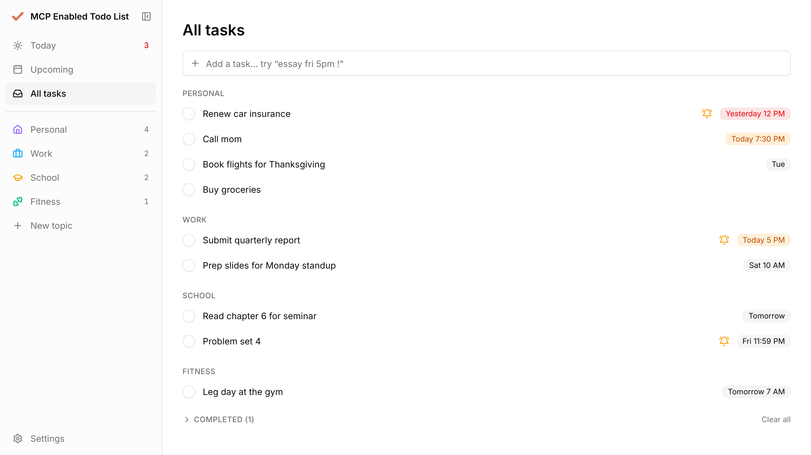
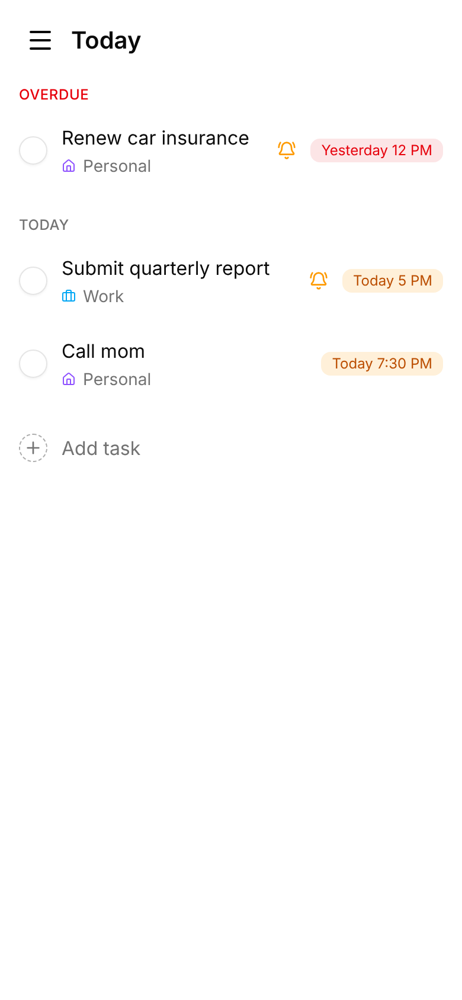

# MCP Enabled Todo List

A deliberately simple, fast todo list split into topics (any lists you like) that nags you about important deadlines and that you can talk to through Claude (MCP).

<picture>
  <source media="(prefers-color-scheme: dark)" srcset="docs/screenshots/all-tasks-dark.png">
  
</picture>

<p align="center">
  
</p>

- **Fast**: local-first. Your list lives on the device and every tap updates instantly. Changes sync in the background to a Cloudflare Worker + D1 at the edge, so API calls take a few ms.
- **Today, Upcoming, All tasks**: overdue items float to the top in red, and each topic gets its own color and icon.
- **Smart quick add**: `report #personal fri 5pm !` → Personal, Friday 5 PM, important. Understands `today`, `tmr`, weekdays, `oct 30`, `11/1`, `in 2 weeks`, `at 7`, `noon`, `#topic`, `!`.
- **Reminders that bug you**: push notifications on phone and desktop. Important tasks ping 1 day, 3 h and 1 h before, at the due time, then **every hour while overdue** until you tick them off or hit *Snooze 1h* (quiet hours 10 PM – 8 AM by default). Normal tasks ping once. Every morning at 7:30 you get a digest push (plus an email if configured).
- **Clippy (AI helper)**: a floating paperclip in the corner. Tap it and type or dictate (mic, Web Speech API) something like *"call mom tomorrow and finish the essay by friday 5pm, it's urgent"*; Claude Haiku turns it into tasks (with Undo). It also pops up on its own every few hours to point out what's overdue, due today or important, with a few suggested tasks you can add in one tap. Paste your Claude API key in **Settings → Clippy** (it's checked, stored server-side and only ever shown as its last 4 characters), or set the `ANTHROPIC_API_KEY` Worker secret. Without a key Clippy still gives the local heads-up.
- **Stays signed in**: one password, once per device; the session renews itself.
- **Settings pop-up**: reminder interval, quiet hours, morning summary, theme, sign out, and Claude access (turn MCP on/off, copy the connector URL, generate a new one).
- **Works everywhere**: installable PWA. On iPhone, open it in Safari → Share → *Add to Home Screen* (required by iOS for notifications), then tap *Turn on reminders* in the sidebar.

## Talk to it with Claude (MCP)

Open **Settings → Claude (MCP)** to copy your private connector URL (`https://<your-worker>.workers.dev/api/mcp/<token>`). The token is the credential: keep it private, and use *Generate a new URL* if it leaks.

- **claude.ai / Claude desktop / mobile**: Settings → Connectors → *Add custom connector* → paste the MCP URL.
- **Claude Code**: `claude mcp add --transport http todo <MCP_URL>`
- **Other MCP clients** (Muse, etc.): use the same URL, or `https://<your-worker>.workers.dev/api/mcp` with the token as `Authorization: Bearer <token>` (or `X-API-Key`). Trailing slashes, CORS preflight and SSE-only clients are handled.

Then ask things like *"what's due this week?"*, *"add 'renew insurance' to Personal for Thursday 3pm, important"*, *"I finished the report"*, *"move everything due today to tomorrow"*.

Tools: `get_overview`, `list_tasks`, `add_task`, `update_task`, `complete_tasks`, `delete_task`, `add_topic`.

## Stack

| Piece | What |
|---|---|
| UI | Next.js 16 (static export) + shadcn/ui (base-vega, Lucide icons) + Tailwind v4 |
| API, MCP, cron | One Cloudflare Worker (`worker/`), free plan |
| Database | Cloudflare D1 (SQLite), `migrations/` |
| Push | Web Push via `@pushforge/builder` (Web Crypto, works on Workers) |
| Email digest (optional) | Resend free tier |

```
app/               page shell, manifest
components/todo/   the app UI
lib/store.ts       local-first store + sync queue
lib/parse.ts       natural-language quick add
public/sw.js       service worker (instant start, push, Done/Snooze buttons)
worker/            API, auth, MCP server, reminders cron
shared/            types + time-zone helpers used by both sides
```

## Develop

```bash
npm install
# create .dev.vars with APP_PASSWORD, SESSION_SECRET, MCP_TOKEN, VAPID_PRIVATE_JWK (see Deploy)
npm run build && npm run dev:api # full app on http://localhost:8790
npm run dev                      # optional: hot-reload UI on :3000, proxies /api to :8790
```

Trigger the reminder cron locally: `curl http://localhost:8790/cdn-cgi/local/scheduled`

## Deploy

```bash
npm run deploy   # next build → D1 migrations → wrangler deploy
```

Secrets (set once): `APP_PASSWORD`, `SESSION_SECRET`, `MCP_TOKEN`, `VAPID_PRIVATE_JWK`, and optionally `ANTHROPIC_API_KEY` (Clippy; can also be pasted in Settings) and `RESEND_API_KEY` + `DIGEST_EMAIL`, via `npx wrangler secret put NAME`.
